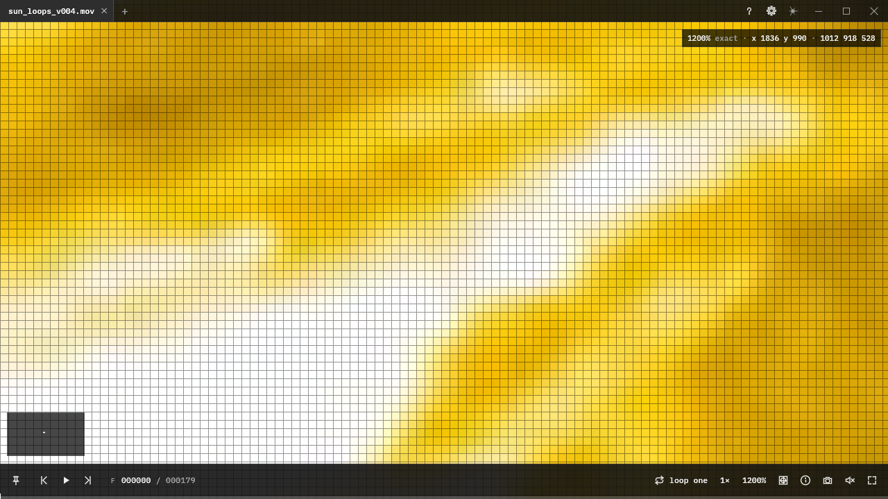
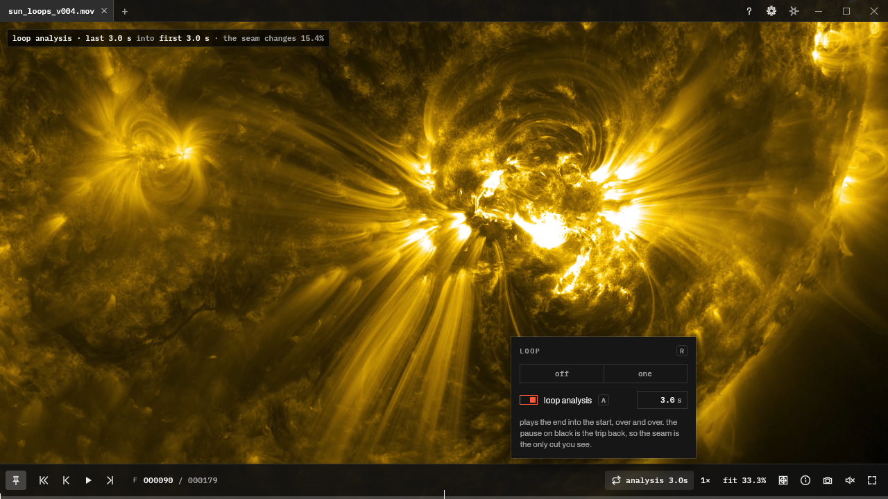
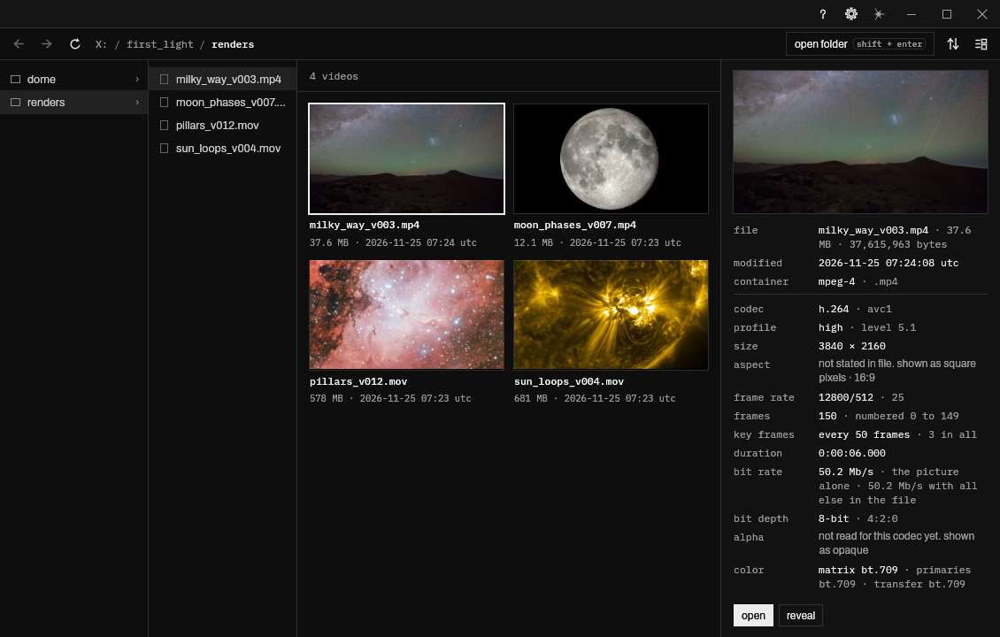

# eyepiece

a video review player for video professionals: extremely fast, lightweight, and only what you need.

[a tridant system](https://tridant.io)


## why eyepiece

- **it opens at once, playing:** a 4K clip is on screen 203 ms (hap q) or 269 ms (h.264) after launch. medians of twelve launches on a 10-core Windows development machine, 2026-11-24.
- **true frames and pixels.** a step is one frame of the file. at 100%, one video pixel is one display pixel.
- **exact or labeled.** metadata comes from the file. anything assumed is labeled.
- **no silent changes.** speed, zoom, mirror or a single channel leaves a chip on the picture.
- **only what you need.** one window. no account, no library, no project files. it never writes beside your media.

## get it

download the [latest release](https://github.com/tridant-io/eyepiece/releases/latest) from GitHub.

**Windows:** download `eyepiece-<version>-windows-setup.exe` and run it. it installs for the current user only, with no admin prompt, into `%LOCALAPPDATA%\Programs\eyepiece`, and adds a Start menu entry. uninstall it from Windows Settings > Apps. it adds eyepiece to Explorer's **Open with** for mov, mp4, m4v, mkv and webm files, and makes it the default for none of them: to do that, settings > general > **make eyepiece the default for videos** opens eyepiece's page in Windows' Default apps, where you choose. it updates itself: a newer release shows an **update** button, which says what changed and installs it. it needs 64-bit Windows 11 and a GPU with Direct3D 11.

**macOS:** download `eyepiece-<version>-macos.dmg`, open it and drag eyepiece to Applications. it is signed with an Apple Developer ID and notarized by Apple, and needs a Mac with Apple silicon and macOS 13 or later. Finder lists it under **Open With** for mov, mp4, m4v, mkv and webm files and leaves the default as it is: to make eyepiece the default for a kind of video, select one in Finder, choose **Get Info**, pick eyepiece under **Open with** and press **Change All**. it does not update itself yet: its **update** button opens the new release, downloaded the same way. this is the first macOS release, and it has been tried on macOS 26 only.

## quick start

1. **open:** drop a file or folder on the window, or press **O** for the browser.
2. **play:** **space** or a click plays and pauses.
3. **step:** **F** and **G**, or **←** and **→**. **shift** with an arrow steps ten. the wheel scrubs.
4. **fullscreen:** **P** or a double-click. **esc** leaves.
5. **controls** show when the pointer moves. the pin at the left of the bar keeps them up.
6. **find a key:** **?** for help, or right-click for every command and type to find one.

## features

### the window

- **the strip** on top holds the tabs, help and settings. drag it to move the window.
- **the bar** at the bottom holds first frame, step and play, the readout, the menus, metadata, screenshot, sound and the timebar. for a still it holds only the zoom, the view, metadata, screenshot and fullscreen; a still that a played folder holds for a time adds play, the loop, and a timebar and readout in seconds.
- **chips** stay on the picture while it differs from the file.
- the window takes the clip's shape, up to 90% of the screen.
- **one window:** a file opened while eyepiece runs, or dropped on it, gets a tab of its own.

---

### playing and stepping

- **J K L** shuttle, each press of J or L doubling the speed up to 8×. **speed** runs from 0.1× to 8×.
- **R** turns looping off and on. a file loops by default.
- **T** switches frames and timecode. timecode is the file's own, drop-frame included, or counts from zero.
- **a file that changes on disk**, such as a new render, takes the old one's place on the same frame.

---

### the timebar


*hovering the timebar shows that frame's picture and number*

click or drag to go to a frame. hover for a picture of the frame under the pointer. ticks mark frames with markup, and missing frames of a sequence are amber.

- **trim:** **shift+[** sets the in point at the frame on screen and **shift+]** the out point. the out frame is kept: in 55, out 129 is 75 frames. a point alone trims to the clip's end or start. **shift+backspace** clears both.
- two markers stand on the timebar and the track outside the trim is dimmed. a chip names the trim, and the hover picture gives a frame's place in it.
- with a trim set, loop one plays only the trim, and loop analysis plays its out into its in. steps and the timebar still reach every frame. loop off plays the whole clip, as does loop all on its way through a played folder.
- a trim belongs to its clip and is saved nowhere: it goes when the tab closes or another clip takes its place. a still has none.

---

### zoom, pan and the navigator


*the picture at 1200% with pixel grid, zoom chip and navigator*

- **0** fits, **1** is 1:1, **2** is 2×. **-**, **=** and **shift+wheel** zoom about the pointer, up to 6400%.
- the zoom chip names the pixel under the pointer and its values. from 1000%, a grid marks every pixel.
- drag or **alt+arrows** to pan. **the navigator** at the lower left shows the whole picture: press in it to go there.

---

### guides


*the view menu with grid and center guides drawn*

**D** shows a grid of tiles and **C** the center lines and circle. they are drawn on the picture, so they stay true zoomed or letterboxed. a screenshot can carry them.

---

### looking at the picture

- the view menu shows one channel (r, g, b or alpha) as gray. **H** mirrors, **V** flips, **Q** turns a quarter. each leaves a chip and never changes the file.
- deep files go to the screen as 16-bit. values above 1.0 stop at white: there is no tone map.

---

### metadata


*the metadata panel pinned at the top right*

rest the pointer on the metadata button to read it. click it or press **I** to pin it. it covers the file, codec, size, frames, rate, bit depth, chroma, color, alpha, audio, timecode and key frames. a value the file does not state is dim, with the assumption in use. faults, such as missing frames or a variable rate, are amber.

---

### loop analysis


*loop analysis with its seam chip and the loop menu*

**A** plays the clip's last seconds into its first, over and over, so the seam is the only cut you see. the chip gives the seam's change, or warns in amber that the last and first frames are the same: the doubled frame that makes a loop stutter.

---

### tabs and comparing versions

- **N** or **+** opens a tab, **[** and **]** go round them, **ctrl+W** closes one and **ctrl+shift+T** brings it back.
- **compare versions:** open `wall_v011.mov` and `wall_v012.mov` in two tabs and flip with **[** and **]**. clips of one size and length switch on the same frame, zoom and pan.

---

### played folders


*a played folder's clip list, odd rates and size in amber*

a folder's clips, played in name order in one tab. press **open folder** in the browser, or drop a folder on the window.

- **R** goes round loop all, one and off. **ctrl+←** and **ctrl+→** go to the clip before and after.
- every clip starts from its first frame, whether play runs on to it or you step to it.
- click the tab to list the clips. a size or rate unlike the first clip's is amber.
- nothing jumps at a cut: the window is sized once and the next clip is ready.
- **play with subfolders** (right-click a folder, or **ctrl+shift+enter**) plays its own clips, then each subfolder's, depth first. the list names each by its path from the folder. it stops at 2000 videos or 10000 folders, and says so.
- a folder dropped on the window, or given to eyepiece at launch, plays with its subfolders the same way.
- **stills:** a played folder plays its videos and sequences. turn on settings > playback > **play stills in a played folder** and its lone stills play too, in name order with the rest: each holds for 5 seconds while play runs (**hold a still for** sets 0.5 to 60), then play goes on as at a clip's end. paused, a still stays. a still among files picked together in the browser holds the same way, whatever the setting.

---

### the browser


*the browser: address, folder columns, cards and metadata column*

**O** lays the browser over the tab and **esc** goes back.

- **the sidebar** lists places, volumes and recent folders.
- **columns** lead to the folder. its videos are **cards**: move the pointer across one to scrub its preview. a path deeper than fits scrolls: each step along it slides the columns there, and the scrollbar under them, dragged or under the wheel, goes back up the path. a click on a folder back up the path leaves the columns under the pointer, and a moment later they slide along to fill the room it left.
- drag the edge of the sidebar, of a column or of the metadata column to resize it; a double click puts it back. the cards give the room, down to 72 wide, and their pictures shrink with them. while not all the columns fit, the cards have an edge of their own just inside their left: drag it right for narrower cards and more columns.
- the keys act in one column or in the cards, as in finder's column view. what is selected there is lit; the folders on the way are dim.
- **the address** shows the path. press it, or **ctrl+L**, to type one.
- the two icons at its right **sort** the folder by name, size, date modified or created (and on a mac, date added), either way, folders first; and switch between **list**, **gallery** and both.
- **shift+click** or **ctrl+click** picks several videos to play as a played folder.
- **shift+click** or **ctrl+click** on folders in a column picks several of them: the cards then show the videos of them all, folder after folder, and **open folder** plays them as one played folder. a plain click goes back to one folder. in the list view, which has no cards, the folders only light up.
- **right-click** a folder, a video or the empty area for what can be done with it: open, play, reveal, copy path and more.
- **network folders are look-only:** names, sizes and dates, until you open a file or press **make previews**.
- previews are cached in the system's cache folder, never near your media.

---

### screenshots and markup


*markup on a frame: rectangle, circle, text and the tools*


*a saved screenshot with its marks and caption*

- **S** saves the file's frame at full size as a png, 16-bit when the file is deeper. **shift+S** saves the view as shown. **ctrl+C** copies the frame.
- the screenshot menu can add a caption, the guides and the markup.
- screenshots go to `eyepiece` in your pictures folder, never beside the media or over an earlier one. the note that says where has **reveal in explorer** (finder on macOS), and stays up while the pointer is on it.
- **markup:** **E** pauses and shows the tools: select, rectangle, circle, pen, text, and ten inks: red, orange, yellow, green, blue, indigo, violet, white, black and gray. hold **shift** while drawing for a square or a round circle, as you see it; press or let go of it mid-drag. pen strokes are smoothed a little as you draw; settings > screenshots sets how much, or turns it off. in a text field, **enter** keeps and **esc** drops. marks stay on their frame until the tab closes.
- **changing marks:** with select, a click selects a mark, a drag moves it and a drag of a corner handle scales it; **shift** keeps its proportion, and text always keeps its own. **delete** or **backspace** takes the selected mark off. a right click on a mark, with any tool, opens its menu: delete, its color, and edit text for text. **ctrl+Z** takes back the last change, one at a time, and **ctrl+shift+Z** or **ctrl+Y** brings it back, until a new change; the row of tools has both. **esc** lets go of the selected mark.

---

### sound

the clip's sound plays with it and keeps the clock. pitch holds from half to double speed. beyond that, in reverse and in loop analysis, sound is off and a chip says so. **M** mutes, **↑** and **↓** set the volume.

---

### settings, help and about


*the settings panel on its general page*


*the about page*

the gear, or **ctrl+,**, opens settings. a change takes effect at once. the screenshots page also holds markup's pen smoothing. settings are also a plain text file you can edit. **?** opens help: the keys, and what eyepiece does.

## keys

on a Mac, command does what control does.

| | key | does |
|---|---|---|
| **play** | space | play / pause |
| | F · G, or ← · → | previous / next frame |
| | shift+F · shift+G, or home · end | first / last frame |
| | shift+← · shift+→ | ten frames back / forward |
| | J · K · L | reverse · stop · forward (J and L double the speed each press) |
| | wheel | scrub, one frame a notch |
| **zoom** | shift+wheel | zoom at the pointer |
| | 0 · 1 · 2 | fit · 1:1 · 2× |
| | - · = | zoom out / in |
| | double-click | fullscreen |
| | alt+arrows | pan |
| **tabs** | O | open: the browser over this tab |
| | N | new tab |
| | [ · ] | previous / next tab |
| | ctrl+← · ctrl+→ | previous / next clip of the folder |
| | ctrl+W | close tab |
| | ctrl+shift+T | reopen closed tab |
| **loop, speed** | R | loop off · one · all |
| | A | loop analysis |
| | shift+- · shift+= | slower / faster |
| | backspace | 1× speed |
| **trim** | shift+[ · shift+] | set in / set out, at the frame on screen |
| | shift+backspace | clear in and out |
| **view** | T | frames / timecode |
| | I | pin metadata |
| | D · C | grid · center lines |
| | H · V · Q | mirror · flip · rotate |
| **screenshot** | S | screenshot of the frame |
| | shift+S | screenshot of the view |
| | ctrl+C | copy frame |
| | E | markup mode |
| | ctrl+Z | undo a change to marks |
| | ctrl+shift+Z · ctrl+Y | redo a change to marks |
| | delete · backspace | take off the selected mark (backspace is 1× speed when none is selected) |
| **sound** | M | mute |
| | ↑ · ↓ | volume up / down |
| **window** | P | fullscreen |
| | shift+P | fullscreen on the next display |
| | right-click | every command |
| | ? | help, on its page of keys |
| | ctrl+, | settings |
| | esc | leave fullscreen, close |

**esc** leaves fullscreen, then drops markup text being typed, then closes a menu, then lets go of a selected mark, then ends markup mode. with help up, any key closes it and then does what it does. **esc** and **?** only close it.

in the browser, letters select names instead of running commands:

| key | does |
|---|---|
| ↑ · ↓ | move in the column. with nothing selected, ↓ takes the first and ↑ the last |
| → · ← | into a folder, on what was selected there, else its first; from a video, into the cards · back to the column before |
| arrows, in the cards | card by card, over the ends of rows; ↑ · ↓ a row. ← from the first card goes back to the column |
| home · end | first / last |
| enter | open the selected card or folder, or play the videos picked |
| shift+enter | open folder: play the folder |
| ctrl+shift+enter | play the folder with its subfolders |
| backspace | up a folder |
| letters | select the first name that starts with them (a second's pause starts over) |
| ctrl+L | type or paste a path into the address |
| alt+← · alt+→ | back / forward (also the keyboard's back and forward keys and the mouse's side buttons) |
| f5 · ctrl+R | read again |
| esc | back to the clip |

## formats

| | |
|---|---|
| **video** | hap (hap, hap alpha, hap q, hap q alpha, hap alpha-only, hap r, hap hdr), notchlc, prores (422 proxy to 4444 xq), h.264, hevc (8 and 10-bit), vp9 |
| **containers** | mov, mp4 (fragmented too), mkv, webm |
| **stills** | png, jpeg, tiff, tga, dpx, exr: one file, or a numbered sequence as one clip |
| **sound** | the clip's own sound track |
| **decoding** | hap on the GPU. h.264, hevc and vp9 on the GPU where it can, else in software. prores and notchlc in software. on macOS, h.264, hevc and prores 422 use the system's decoder |
| **untested** | hap q alpha and hap alpha-only on real files. exr compressions other than none, rle and zip |
| **not yet** | mxf, mpeg-ts and other containers that do not list their frames up front |

## privacy

- **the update check is all eyepiece sends.** at most once a day it asks GitHub for the latest release's manifest, with only `eyepiece/<version>` as its user agent: no account, id, file name or setting. a switch in settings turns it off, and a release is downloaded only when you press **update**.
- on a network volume, the browser reads only the folder's listing until you open a file or ask.
- what eyepiece keeps stays on your machine: its settings file, the preview cache and your screenshots.

## build from source

needs Windows, Rust (stable, msvc target) and the Visual Studio C++ build tools. the tests need a GPU with a video decoder.

```powershell
# once: downloads the LGPL FFmpeg shared build and libclang into third_party
powershell -NoProfile -ExecutionPolicy Bypass -File scripts\setup.ps1

cargo build --release
cargo run --release -- wall_v012.mov
cargo test
```

for the end-to-end tests, packaging, the macOS build and everything else, see [docs/development.md](docs/development.md).

## license

eyepiece is open source under the [Common Public Attribution License 1.0](LICENSE) (CPAL-1.0). Copyright (c) 2026 Tridant, Inc.

every copy and derivative must show, in its user interface each time it runs, the notice "Copyright (c) 2026 Tridant, Inc.", the phrase "a tridant system", the tridant mark and https://tridant.io (Exhibit B of the [LICENSE](LICENSE)). removing the attribution, or crediting another party more prominently, breaks the license.

"eyepiece", "tridant", "a tridant system" and the tridant mark are trademarks of Tridant, Inc., which the license does not cover: see [TRADEMARKS.md](TRADEMARKS.md).

third-party notices ship with the program: FFmpeg under the LGPL, as separate libraries you may replace; the Rust crates, each with its license; and the typefaces IBM Plex Mono and Archivo under the SIL Open Font License.

## credits

eyepiece is built by [tridant](https://tridant.io). the screenshots show six-second excerpts, without sound and re-encoded, of:

- [Moon Phase and Libration, 2026](https://svs.gsfc.nasa.gov/5587/): NASA's Scientific Visualization Studio, Ernie Wright, Noah Petro and James Tralie. public domain.
- [Thermonuclear Art](https://svs.gsfc.nasa.gov/12034/): NASA's Goddard Space Flight Center; the SDO Team, Genna Duberstein and Scott Wiessinger, producers. public domain.
- [Zoom into Webb's View of the Pillars of Creation](https://esawebb.org/videos/weic2216d/): NASA, ESA, CSA, and STScI, ESO, NOIRLab/NSF/AURA, T.A.Rector, B.A.Wolpa, ESA/Hubble, J. DePasquale, A. Koekemoer, A. Pagan, N. Bartmann, M. Zamani. [CC BY 4.0](https://creativecommons.org/licenses/by/4.0/).
- [Dusk till dawn over Paranal](https://www.eso.org/public/videos/uhd_cm_paranal_3/): ESO / C. Malin. [CC BY 4.0](https://creativecommons.org/licenses/by/4.0/).

none of them endorses eyepiece or tridant.
