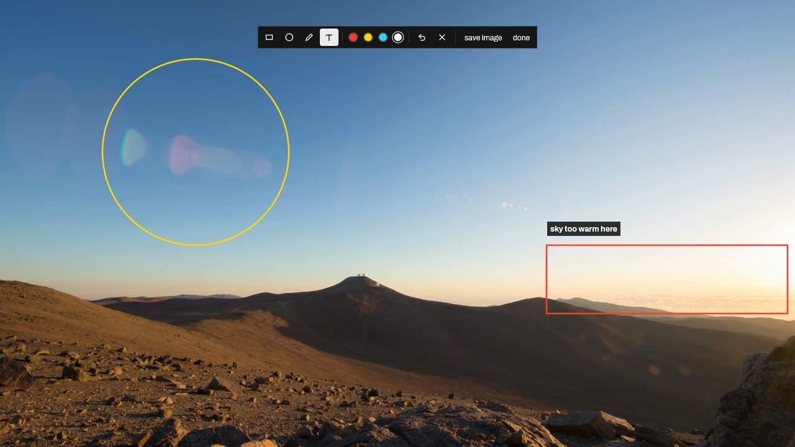

# eyepiece

a video review player for video professionals: extremely fast, lightweight, and only what you need.

[a tridant system](https://tridant.io)


## why eyepiece

review is a close look at one file. eyepiece does that, and very little else.

- **it opens at once.** a 4K clip is on screen about a quarter of a second after launch: 203 ms for hap q and 269 ms for h.264, from the process starting to the first picture (medians of twelve launches on a windows development machine with a 10-core cpu, 2026-11-24). a file opens playing.
- **true frames.** a step is one frame of the file. frames are counted from the file's own table, never from a summary field, so the count and the frame number on screen are the file's. what an edit list hides is left out.
- **true pixels.** at 100% one pixel of the video is one pixel of the display. zoom in and each pixel is a square, with its values under the pointer. guides are drawn on the picture, not on the window.
- **it says exactly what the file is.** every fact in the metadata is read from the file. what the file does not say is labeled as such, with the assumption in use: nothing is guessed.
- **nothing changes what you see without saying so.** speed, zoom, mirror, a single channel: each leaves a chip on the picture until you undo it.
- **only what you need.** one window with no title bar: the picture, and controls that come up when the pointer moves. no account, no library, no project files, no installer. it never writes into or beside your media, holds no lock on it, and sends nothing over the network.

## get it

### windows

there is no public release yet. releases will be on the [github releases page](https://github.com/tridant-io/eyepiece/releases), as a zip: unpack it into a folder of your own (for example `%LOCALAPPDATA%\Programs\eyepiece`) and run `eyepiece.exe`. there is no installer: the folder is the install, and nothing asks for an admin prompt.

until then, [build it from source](#build-from-source).

eyepiece needs 64-bit windows (it is built and tested on windows 11) and a gpu with direct3d 11. h.264, hevc and vp9 use the gpu's video decoder where it takes the stream, and decode in software where it does not.

### macos

in development, with no release. the mac build opens its window, plays clips (with the system's decoder for h.264, hevc and prores 422), steps, goes fullscreen, shows the browser and saves screenshots, and its tests pass. so far it has been driven only by test scripts: nobody has used it by hand, and the pointer, keyboard, trackpad, dropping a file, sound and a second display are untried there. there is no app bundle and no signed build yet.

## quick start

1. **open something.** drop a file or a folder on the window, start eyepiece with a path (`eyepiece.exe wall_v012.mov`), choose `eyepiece.exe` in explorer's "open with", or press **O** for the browser. started with no file, eyepiece shows the browser.
2. **play.** a file opens playing. **space**, or a click on the picture, plays and pauses.
3. **step.** **F** and **G**, or **←** and **→**, step one frame back and forward. **shift** with an arrow steps ten. **home** and **end** go to the first and last frame. the wheel scrubs one frame a notch.
4. **fill the screen.** **P** or a double-click on the picture goes fullscreen, **shift + P** goes fullscreen on the next display, and **esc** comes back.
5. **the controls** come up when the pointer moves, and go 2.4 s after it rests off them or leaves the window. keys never bring them up. the pin at the far left of the bar keeps them up, and is kept between runs.
6. **find a key.** **?** opens help on its page of keys. a right-click lists every command with its key, and resting on a button names what it does and its key.

## features

### the window

- **the strip** along the top holds the tabs, **+** for a new tab, then at its right **?** for help, the gear for settings and the tridant mark, then minimize, maximize and close. drag it to move the window; double-click it to maximize. rest the pointer on the mark for the version and a link to tridant.io; press it for about. while a newer release is out, a quiet **update** button stands left of **?**.
- **the bar** along the bottom holds the pin, previous frame, play, next frame and the readout (the frame or timecode, and the clip's length); then the loop, speed and zoom menus, the view menu, metadata, screenshot, sound and fullscreen; and the full-width timebar under them.
- **chips** stay on the picture while it is not as the file has it: speed, zoom, loop analysis, mirror, flip, rotate, one channel alone, sound off.
- with the controls away, what a key did is said at the lower left for a moment: the frame a step landed on (or its timecode), the clip a tab or page key brought up, the loop mode, the volume or the mute.
- the window takes the clip's shape: its own size when that fits in 90% of the screen, fitted to 90% when it does not, and never smaller than 640 × 360. it grows when you open a bigger clip, and never shrinks.
- drag the picture to move the window while all of it is in view; zoomed in, a drag pans instead. the system's win + arrow keys and the maximize button arrange the window; a dragged window does not snap to the screen's edges.
- **one window.** starting eyepiece again with a file opens that file in a new tab of the window already open and brings it forward; started with no file, it only brings the window forward.
- **drop** a file on the window and it opens in a tab of its own, never in place of what you are looking at. a folder dropped on the window plays as a [played folder](#played-folders). one item is taken from a drop; to play several files, pick them in the [browser](#the-browser).
- **fullscreen** (**P**, or a double-click) fills the display the window is on, and **shift + P** fills the next display. a double-click leaves play and the frame as it found them. filling the display takes the controls away until the pointer moves again, unless they are pinned.
- the window's title, which the taskbar shows, names the clip, the frame and the count, the size, the codec and how it is decoded, and the rate. it also counts trouble: `· 3 late` for refreshes that went by without the frame due, `· 2 could not be shown` for frames the file could not give, and `· reading` while a frame is on its way.
- a file that does not open gets a tab that says why. a file with no picture (sound alone) is not opened.

### playing and stepping

- **play and pause** with **space**, a click on the picture, or the play button.
- **shuttle** with **J K L**: **L** plays forward and **J** backward, each press doubling the speed up to 8×, and **K** stops.
- **speed**: **shift + -** and **shift + =** step it from 0.1× to 8×, and **backspace** goes back to 1×. the speed menu has five stops, a slider and a field to type into. any speed other than 1× leaves a chip.
- **loop**: **R** turns looping off and on (for a played folder it goes round off, one and all). a file loops by default. the loop menu holds the same choices and the loop analysis switch.
- **step** with **F** and **G** or the arrows, ten at a time with **shift** and an arrow, to the first and last frame with **shift + F** and **shift + G** or **home** and **end**, and by a notch of the wheel.
- in h.264, hevc and vp9, a step back is instant within the frames the player keeps (about 20 at 4K). a step past them decodes again from the key frame before, which takes longer the further apart the file's key frames are. playing backward in those formats runs in short bursts. hap and prores frames stand alone, so they step and play backward evenly.
- **the readout** counts frames or timecode: **T**, or a click on it, switches. timecode is the file's own where it carries one (a quicktime timecode track or a timecode tag), drop-frame included (01:00:59;29 is followed by 01:01:00;02); otherwise it is counted from 00:00:00:00, and the metadata says so. frame numbers start at 0; `first_frame = 1` in the [settings file](#settings) starts them at 1.
- **a file that changes on disk** is picked up. eyepiece holds no lock on what it has open, so a render can write over it. once the new file has held still for half a second it takes the old one's place, on the same frame, with the zoom and pan when it is the same size, and a line says so: `wall_v012.mov changed on disk at 14:32 · same frame`. a file caught while it is still being written is left alone until its next change. a file that goes away is said too, and what was showing stays.

### the timebar

- click or drag on the timebar to go to that frame.
- rest the pointer on it and a small picture of the frame under the pointer stands over its number. for local files eyepiece makes a set of small frames in the background once a clip is up (one every two seconds, at most 100, none while the clip plays), so a picture comes at once; then the frame under the pointer is read and takes its place. in h.264, hevc and vp9 with key frames far apart, the picture is the nearest key frame, so a hover never costs a whole group's decode.
- on a network volume nothing is made ahead: the picture comes when the frame under the pointer has been read.
- a tick over the timebar marks each frame that carries [markup](#screenshots-and-markup); missing frames of a sequence are marked amber.


### zoom, pan and the navigator

- **0** fits the picture, **1** is 1:1 and **2** is 2×. **-** and **=** zoom out and in one stop. all of them zoom about the pointer when it is over the picture.
- **shift + wheel** zooms one stop a notch about the pointer, from 12.5% to 6400%, with fit as a stop of its own.
- the zoom number on the bar opens the zoom menu: fit, 1:1, 2×, 4×, 8×, a slider, and a field to type a percentage into.
- while a zoom is set, a chip at the top right gives it, says whether every video pixel is a whole number of display pixels (**exact**) or not (**scaled**), and names the pixel under the pointer with its values. it fades 2 s after the pointer rests.
- from 1000% up, a dark line marks every pixel's edge.
- **pan** by dragging the picture, as far as its edge, or with **alt** and the arrows, an eighth of the window at a time.
- **the navigator** stands at the lower left while the picture is zoomed past the window: a small plan of the whole picture with the part in view marked. press or drag in it to bring that part to the middle of the window. it is plain while the pointer moves and faint when it rests.


### guides

- **D** shows a grid of tiles, **C** the center lines and circle. the view menu sets the tile's size in pixels (240 × 240 at first).
- guides are drawn on the picture, not the window, so they stay true when a clip is letterboxed or zoomed. they are kept between runs.
- their color is `guide_color` in the [settings file](#settings) (`#3df0ff` at first).
- a screenshot can carry them.


### looking at the picture

- **the view menu** shows one channel alone (r, g, b or alpha) as a gray picture, and holds mirror, flip and rotate. **H** mirrors, **V** flips and **Q** turns the picture a quarter, for rear projection and turned panels. each changes the view, never the file, and leaves a chip.
- **pixel values**, in the zoom chip, are the red, green and blue the screen is sent, on the scale of the file's bit depth (0 to 255 for 8-bit, 0 to 1023 for 10-bit), read from the frame at its own size. they are not the stored y'cbcr codes.
- **chroma** in 4:2:0 and 4:2:2 files is blended up from the four samples round each pixel, each where the file sites it. `chroma = nearest` in the settings file takes the nearest sample instead, and the metadata says which is in use.
- **deep files**: 8-bit files stay 8-bit, and 10, 12 and 16-bit ones go to the screen as 16-bit. exr is shown as float through the srgb curve, with a chip saying so. values above 1.0 (exr, hap hdr) stop at white: there is no tone map.
- a file that does not name its color matrix gets the usual assumption (bt.709 at 720 lines and up, bt.601 below), and the metadata says so.

### metadata

- rest the pointer on the metadata button to read it; click it, or press **I**, to pin it at the top right. **copy all** puts it on the clipboard.
- it reads the file's name, size, date and path; the container; the codec and its profile; the picture's size, frame count, frame rate and duration; bit depth and chroma; color (matrix, primaries, transfer) and range; alpha; the audio; the timecode; and for a sequence, its run of files and any missing frames.
- **aspect** says whether the pixels are square and the picture's shape (16:9, 2.39:1). a file that asks for other pixels (anamorphic footage) is drawn here with square pixels, as stored, and the row says so. **profile** gives h.264's and hevc's profile and level ("high · level 5.1"). **key frames** says how far apart they are ("every 250 frames"), where not every frame is one.
- the bit rate is worked out, not read from the file's summary: the bytes stored for the frames shown, and all of the file's bytes, each over the picture's length.
- **labeled, never guessed.** every value is read from the file, or is dim and says the file does not state it and what is assumed instead. frame counts and rates come from the file's own table.
- a fault in the file (a sound track shorter or longer than the picture, frames missing from a sequence, a variable frame rate, a first frame that cannot be read) is amber, and an amber dot on the metadata button says the file has one.
- a few facts are not read yet, and the panel says so where it applies: alpha in h.264, hevc and vp9, vp9's bit depth, and color facts for stills.


### loop analysis

- **A**, or the switch in the loop menu, plays the clip's last seconds into its first, over and over, with a short pause on black for the trip back, so the seam is the only cut you see. the loop menu sets the seconds each side of the seam (0.5 to 10, 3 at first).
- the chip says how the seam looks in numbers: the mean change of a pixel from the last frame to the first, as a part of full scale (`the seam changes 2.4%`), or, in amber, that the two frames are the same: the doubled frame that makes a loop stutter.
- sound is off in loop analysis.


### tabs and comparing versions

- **N** or **+** opens a new tab, a click brings one up, **[** and **]** go round them, **ctrl + W** or a tab's close mark closes one, and **ctrl + shift + T** brings the last one closed back, on its frame, zoom and pan.
- **compare versions:** two tabs that hold clips of one size and length change places on the same frame, zoom and pan. open `wall_v011.mov` and `wall_v012.mov` in two tabs, and **[** and **]** flip between them on the spot.
- a file chosen in the browser opens in the tab the browser is in. a file dropped on the window, or handed over by starting eyepiece again, gets a tab of its own. a lone tab holding only the browser is named "browser".
- more tabs than fit narrow, then the strip scrolls; the wheel over the strip moves the tabs.
- each tab keeps its clip open, ready to flip to, so many 4K tabs use a lot of memory until they are closed.

### played folders

a played folder is a folder's clips, played one after another in name order, in one tab.

- **start one** from the browser with **open folder** (**shift + enter**), or pick several videos there and press **open selected** (or **enter**). a folder dropped on the window, given at launch or handed over by a second launch plays too.
- **loop all** (the folder's default) goes round the folder; **one** stays in the clip that is up; **off** plays the folder through once and stops on its last frame.
- **ctrl + ←** and **ctrl + →** (**cmd** on a mac) go to the clip before and after, round the ends. the arrows either side of the clip's place on the tab do the same.
- the tab names the folder, the clip's place in it and the clip (`wall / ‹ 2 of 19 › wall_v012.mov`). a click on the tab lists the folder's clips, each with its size, rate and frames; a size or rate that differs from the first clip's is amber, which is how the one odd clip in a folder is found. a click on a row goes to that clip.
- the window is sized once, to the folder's biggest clip, and every clip is fitted inside it, so nothing jumps at a cut. the clips before and after the one on screen are kept ready, so a cut only swaps pictures.
- the loop mode, speed, look and loop analysis carry from clip to clip; between two clips of one size and length, the frame, zoom and pan carry too, so two versions flip on the spot.
- clips that are not on the disk (a cloud folder's placeholders) and lone stills are left out, and a line says how many. a clip that does not open is passed over, and a line says which.
- a folder on a network volume is asked about first: a line says how many clips playing it will open, and **open folder** again within a few seconds plays it. there each clip is opened only as it plays, and the list shows names alone.


### the browser

the browser shows when eyepiece starts with no file and in a new tab; **O** lays it over the tab that is up, and **esc** goes back to the clip.

- **the sidebar** lists the places (downloads, desktop, documents, videos, pictures), the folders pinned in explorer, the volumes (a local disk by its label and letter, a network drive with a "net" tag), and the last five folders you opened or played files from.
- **the folders** run as columns from the place to the folder you are in. the folder's videos and sequences show as **cards**, each with a poster. rest the pointer on a card and it makes 24 preview frames (coarse first, kept in the cache after); moving across the card then scrubs through them, with a line where the pointer is and the number of the frame shown. a fault, such as a sequence's missing frames, shows on the card before you open anything.
- **the metadata column** at the right shows the selected file's poster and facts, and its actions: **open**, and **reveal** (shows a local file selected in explorer) or **read metadata** (for a file that is look-only).
- **the address** across the top names every folder from the drive or share down to the one shown. press a folder in it to go there. press the rest of the line, or **ctrl + L**, to type or paste: a folder's name, a path, or a path to a video, which opens it (a path in quotes, as explorer copies one, is fine). **enter** goes, and **esc** leaves the browser where it was.
- **back, forward and read again** stand at the address's left. back and forward also answer **alt + ←** and **alt + →**, the keyboard's own back and forward keys and the mouse's side buttons; read again (**f5** or **ctrl + R**) lists the folders on screen anew and reads the selected file's metadata again.
- **list, gallery or both**, chosen at the address's right end and kept between runs: **list + gallery** (the default) shows the folder's entries in a column beside its cards, **gallery** the cards alone, and **list** the column alone, with the selected file's poster in the metadata column. **open folder** stands beside the choice when the folder holds more than one video.
- **pick several:** **shift +** click picks every video from the last one pressed to this one, and **ctrl +** click adds or drops one. the action then reads **open selected**, and it or **enter** plays the videos picked, in the folder's order, as a played folder. a plain press lets them go.
- **resize** the sidebar, the folders' columns and the metadata column by dragging their edges. a double-click on an edge puts it back, and the widths are kept between runs.
- **the pointer:** a click selects, a double-click opens a card or enters a folder, and the wheel scrolls whatever is under the pointer.
- **keys:** the arrows move through a column and into the cards, **enter** opens, **backspace** goes up a folder, and letters typed together select the first name that starts with them (see [the browser's keys](#in-the-browser)).
- **network folders are look-only.** on a network volume the browser lists names, sizes and dates from the folder's listing and opens nothing: no posters, no previews, no metadata. a note offers **make previews**, with the number of files it will read; asked, that folder's cards get posters and previews until eyepiece closes. you can still open a file or read one file's metadata. a cloud file that is not on the disk is treated the same.
- an mkv, a webm or a fragmented mp4 must be read through to count its frames, so its card stays plain until you open it.
- posters and previews are kept in the system's cache folder (`%LOCALAPPDATA%\eyepiece\cache\previews`), 2 GB at most, and nowhere near your media.


### screenshots and markup

- **S** saves the file's own frame at full size, as a png: 16 bits a channel when the file is deeper than 8, with the file's alpha when the frame has any (stills, hap alpha, hap r, prores 4444). **shift + S** saves the view as shown, which is how you save one part of the picture. **ctrl + C** copies the frame to the clipboard (8 bits, the frame alone).
- the screenshot menu has three switches, kept between runs: a **caption** under the picture, so it covers no pixel (the clip's name, the frame, the timecode, the size and the rate); the **guides**, when they are showing; and the **markup** (on at first).
- screenshots go to `Pictures\eyepiece` (or `screenshot_folder` in the settings file), named by clip and frame: `wall_v012.f000742.png`, then `wall_v012.f000742 (2).png`. never beside the media, never over an earlier one. a line in the window says what was written.
- **markup:** **E**, or "markup mode" in the screenshot menu, stops play and puts a row of tools at the top of the picture: rectangle, circle, pen and text, four inks (red, yellow, cyan, white), undo, clear (the frame on screen), save image and done. drag on the picture to draw: in markup mode a drag moves neither the window nor the picture, a click does not play, and only the window's top and bottom edges bring the controls up. with the text tool, a click opens a field: **enter** keeps what was typed and **esc** drops it. **ctrl + Z** takes back the last mark on the frame.
- marks sit on the frame they were drawn on, in the file's own pixels, so they stay put through zoom, pan, mirror, flip and rotate, and their lines and text keep one size on screen. a tick over the timebar marks each frame that carries marks. they last until the tab closes, and are kept nowhere but in a screenshot.




### sound

- a clip's sound plays with it, and is its clock: the picture follows the sound.
- the pitch holds from half speed to double. beyond that, in reverse, when shuttling faster than 1× and in loop analysis, the sound is off and a chip says "audio off".
- **M** or the speaker button mutes. the speaker's slider comes out while the pointer is on it, and **↑** and **↓** turn the volume a tenth (**↑** also ends a mute). the volume and the mute are kept between runs.
- only the tab that is up is heard, through the system's default output. channels beyond stereo are mixed down.

### settings, help and about

the gear on the strip, or **ctrl + ,**, opens settings: a panel over the picture with a page for each part of the player. a change takes effect at once; there is no save button, and each page has "reset this page". esc, the close mark or a press outside the panel closes it.

- **general:** play a file when it opens (on at first), open a file from the browser in this tab or a new one, one window, keep the controls up, how long the controls stay after the pointer rests, remember the window's size, check for updates when eyepiece starts, and where the settings file is.
- **about:** the version and build, what eyepiece is, "a tridant system", whether an update is out (with check now), the links and the license.
- **playback:** the loop modes, loop analysis seconds, frames or timecode, the first frame's number (0 or 1), volume and mute.
- **display:** the color behind the picture (black, dark gray, mid gray or your own), chroma, the guides, their tile and their color.
- **browser:** where it starts (where it was last, or a fixed folder), recent folders, and the preview cache: its size, its limit and clearing it.
- **screenshots:** the folder (never one that holds media) and what a saved picture carries.
- **open-source notices:** the notices installed beside the program, with find.

**?** on the strip, or the **?** key, opens help: the keys, and a short page on what eyepiece does. any key closes help and then does what it does, so a key read there can be pressed at once.

the settings are kept in `%APPDATA%\eyepiece\settings.txt`, one `key = value` a line, plain text and editable by hand; a line taken out gets its default. speed, zoom, pan, mirror, flip, rotate and channels start as the file has them in every tab, and markup is never kept.


### updates

on windows, eyepiece looks for a newer release on github once a frame is up, at most once a day. a newer one shows as a quiet **update** button on the strip, and nothing else: no prompt, no dialog. the button opens what the release is and what changed in it, with **update** and **cancel**. update downloads the release, checks every file against the sha-256 the release lists and that the program and its libraries are signed by Tridant, Inc. as the running one is, puts it in place of the running build and starts it again on the files open now. any failure leaves the installed version as it was and says why. a build that is not signed never updates itself. the switch is in settings, general; about has check now. the mac's updates will come with its app bundle, which is not built yet.

## formats

| | |
|---|---|
| **video** | hap (hap, hap alpha, hap q, hap q alpha, hap alpha-only, hap r, hap hdr), notchlc, prores (422 proxy to 4444 xq), h.264, hevc (8 and 10-bit), vp9 |
| **containers** | mov, mp4 (fragmented too), mkv, webm |
| **stills** | png, jpeg, tiff, tga, dpx, exr: one file, or a numbered run of them as one clip |
| **sound** | the clip's own sound track |

how each decodes:

- **hap**: eyepiece's own code, which hands the compressed blocks to the gpu as stored. hap q alpha and hap alpha-only follow the published spec and have not been tried on a real file yet.
- **h.264, hevc, vp9**: the gpu's video decoder where it takes the stream (h.264 and hevc are drawn from the decoder's own surface, with no copy). a stream the gpu does not take (often 10-bit h.264 or 4:2:2) decodes in software.
- **prores and notchlc**: ffmpeg, in software, on every core. on macos, prores 422 goes through the system's decoder.
- **stills and sequences**: decoded on up to eight workers at once, and kept in memory up to a quarter of ram.

limits:

- prores 4444 xq at 4K and 60 frames a second does not hold its rate in software: the windows development machine (10 cores, 20 threads) decodes about 41 to 47 frames a second of it (2026-11-24).
- hdr and float values above 1.0 stop at white: there is no tone map yet.
- an mkv, a webm or a fragmented mp4 is read through once when it opens, to count its frames: nothing is decoded, what was on screen stays up, and a line counts the frames meanwhile.
- a variable frame rate plays each frame for its own time, from mov, mp4 and mkv only, and the title says `variable rate`. mkv and webm keep time in milliseconds, so their rate is derived from the frames' times and says `derived`.
- a numbered sequence plays at the rate the file states (exr can) or at 24, and says "assumed"; the rate cannot be typed in yet. a missing frame is marked amber on the timebar and says so when shown. exr compressions other than none, rle and zip are untested.
- timecode is read from a quicktime timecode track or a timecode tag only.
- not yet: mxf, mpeg-ts and other containers that do not list their frames up front, and other codecs (a file that does not play gets a tab that says why).

## keys

on a mac, command does what control does.

### play

| key | does |
|---|---|
| space | play / pause |
| F · G, or ← · → | previous / next frame |
| shift + F · shift + G, or home · end | first / last frame |
| shift + ← · shift + → | ten frames back / forward |
| J · K · L | reverse · stop · forward (each press of J or L doubles the speed) |
| wheel | scrub, one frame a notch |

### zoom

| key | does |
|---|---|
| shift + wheel | zoom at the pointer |
| 0 · 1 · 2 | fit · 1:1 · 2× |
| - · = | zoom out / in |
| double-click | fullscreen |
| alt + arrows | pan |

### tabs

| key | does |
|---|---|
| O | open: the browser over this tab |
| N | new tab |
| [ · ] | previous / next tab |
| ctrl + ← · ctrl + → | previous / next clip of the folder |
| ctrl + W | close tab |
| ctrl + shift + T | reopen closed tab |

### loop and speed

| key | does |
|---|---|
| R | loop off · one · all |
| A | loop analysis |
| shift + - · shift + = | slower / faster |
| backspace | 1× speed |

### view

| key | does |
|---|---|
| T | frames / timecode |
| I | pin metadata |
| D · C | grid · center lines |
| H · V · Q | mirror · flip · rotate |

### screenshot

| key | does |
|---|---|
| S | screenshot of the frame |
| shift + S | screenshot of the view |
| ctrl + C | copy frame |
| E | markup mode |
| ctrl + Z | take back a mark |

### sound

| key | does |
|---|---|
| M | mute |
| ↑ · ↓ | volume up / down |

### window

| key | does |
|---|---|
| P | fullscreen |
| shift + P | fullscreen on the next display |
| right-click | every command |
| ? | help, on its page of keys |
| ctrl + , | settings |
| esc | leave fullscreen, close |

**esc** leaves fullscreen first, then drops markup text being typed, then closes a menu, then ends markup mode. with help up, any key closes it and then does what it does; **esc** and **?** only close it.

### in the browser

in the browser, letters select names instead of running commands.

| key | does |
|---|---|
| ↑ · ↓ | move in the last column |
| → · ← | enter a folder, or move into the cards from a clip · go back out |
| arrows, in the cards | move card by card; ← from a row's first card goes back to the columns |
| home · end | first / last |
| enter | open the selected card, or play the videos picked |
| shift + enter | open folder: play the folder |
| backspace | up a folder |
| letters | select the first name that starts with them (a pause of a second starts over) |
| ctrl + L | type or paste a path into the address |
| alt + ← · alt + → | back / forward (also the mouse's side buttons) |
| f5 · ctrl + R | read again |
| esc | back to the clip |

## privacy

- **the update check is all eyepiece sends.** on windows, at most once a day, it asks github for the latest release's manifest, with only `eyepiece/<version>` as its user agent: no account, id, file name or setting. like any connection it shows your public address and the time. a switch in settings turns it off. the release itself is downloaded only when you press update. the links on about and in help open your browser; eyepiece itself sends nothing else.
- reading a file on a share is the file system's work, and on a network volume the browser reads only the folder's listing until you open a file or ask.
- what eyepiece keeps stays on your machine: its settings file, the preview cache in the system's cache folder, and the screenshots you save.

## build from source

needs windows, rust (stable, msvc target) and the visual studio c++ build tools. the tests need a gpu with a video decoder: they check hardware decoding of h.264 and hevc, and fail without one.

```powershell
# once: downloads the lgpl ffmpeg 9.0 shared build and libclang into third_party
powershell -NoProfile -ExecutionPolicy Bypass -File scripts\setup.ps1

# build and run
cargo build --release
cargo run --release -- wall_v012.mov

# unit tests, then end to end on the release build (windows open for a few seconds)
cargo test
powershell -NoProfile -ExecutionPolicy Bypass -File tests\e2e.ps1

# package: runs the tests and the end-to-end test, then puts the program,
# its four ffmpeg libraries and the notices in dist\eyepiece
powershell -NoProfile -ExecutionPolicy Bypass -File scripts\package.ps1 -NoSign
# the same, then copied to %LOCALAPPDATA%\Programs\eyepiece
powershell -NoProfile -ExecutionPolicy Bypass -File scripts\package.ps1 -NoSign -Install
```

`-NoSign` skips signing, which needs tridant's certificate. for the timing checks, the mac build and everything else a contributor needs, see [docs/development.md](docs/development.md).

## license

eyepiece is open source under the [Common Public Attribution License 1.0](LICENSE) (CPAL-1.0). Copyright (c) 2026 Tridant, Inc.

its attribution term means every copy of eyepiece, and every program made from its code, must show Tridant's attribution in its user interface each time it runs: the notice "Copyright (c) 2026 Tridant, Inc.", the phrase "a tridant system", the tridant mark and https://tridant.io, as Exhibit B of the [LICENSE](LICENSE) sets out. removing that attribution, or showing another party's credit more prominently, breaks the license.

**trademarks.** "eyepiece", "tridant", "a tridant system" and the tridant mark are trademarks of Tridant, Inc. the license covers the code, not the names or the mark: see [TRADEMARKS.md](TRADEMARKS.md) for what you may do with them.

**third-party notices.** every build ships `THIRD-PARTY-NOTICES.txt` beside the program.

- **FFmpeg**, under the LGPL, ships as four separate libraries beside the program (`avformat`, `avcodec`, `avutil`, `swresample`), which you may replace with your own build. its license travels with them as `ffmpeg-LICENSE.txt`, and the notices say where its source is and how to put other libraries in place of ours.
- **the rust crates** compiled into the program are listed in the notices, each with its license text.
- **the typefaces**, IBM Plex Mono and Archivo, are built into the program under the SIL Open Font License, and their licenses ship beside it.

## credits

eyepiece is built by [tridant](https://tridant.io).
